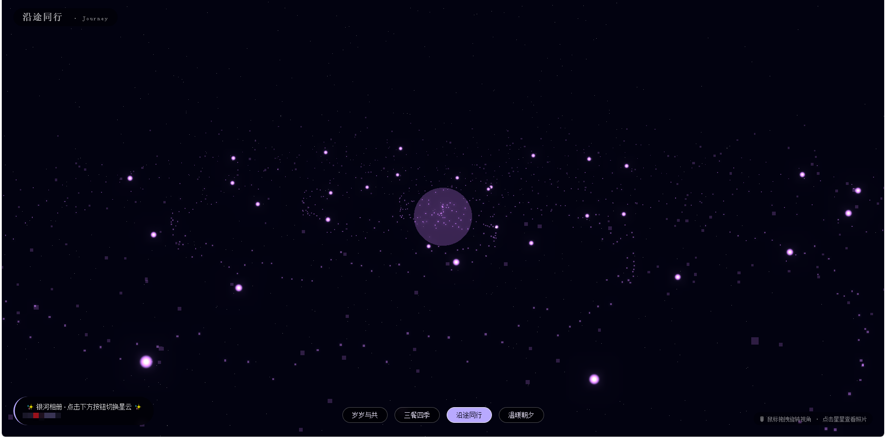

# ✨ 银河相册
> 基于 Three.js + Cloudflare Pages + Cloudflare Worker + R2 + Zero Trust Access 实现的私人星云相册。
> 将照片化作宇宙星辰，点击星星查看照片，支持多组星云相册，基于邮箱鉴权保护你的私人图片。

⚠️ **本项目不支持一键部署**，全部配置需要手动在 Cloudflare 网页控制台完成，无需本地命令行工具。

## 📦 项目架构
- **Cloudflare Pages**：托管静态前端页面 `index.html`
- **Cloudflare Worker**：扫描 R2 生成相册 JSON、图片代理、CORS跨域处理
- **Cloudflare R2 对象存储**：存放原始图片，**禁止开启公开访问**
- **Cloudflare Zero Trust Access**：邮箱鉴权，未授权用户无法加载图片资源

## 📁 文件说明
| 文件         | 说明                                                 |
| ------------ | ---------------------------------------------------- |
| `index.html` | 前端 Three.js 页面，部署前需要修改 Worker 地址占位符 |
| `worker.js`  | Cloudflare Worker 完整源码，负责读取R2与图片代理     |

## 🚀 部署步骤（网页端操作）
### 1. 创建 R2 对象存储桶
1. Cloudflare控制台 → `Storage & Databases` → `R2 对象存储` → 创建存储桶
2. 桶名称使用小写英文，**不要开启公开访问**
3. 在桶内手动创建4个文件夹，名称必须严格一致：

岁岁与共 三餐四季 沿途同行 温暖朝夕

4. 将图片上传至对应文件夹，支持格式：`jpg jpeg png gif webp`

> 💡 图片命名规则：文件名以 `top` 开头的图片会被优先渲染为固定星星，例：`top_纪念日.jpg`

### 2. 部署 Cloudflare Worker
1. `Workers & Pages` → `Create application` → `Create Worker`
2. 创建完成后点击「Quick edit 快速编辑」，清空原有代码，粘贴全部 `worker.js` 内容
3. 进入 `Settings` → `Variables and bindings` → `Add binding`
4. 绑定类型选择 `R2 bucket`，**变量名必须大写 `MY_BUCKET`**，选择刚刚创建的R2存储桶，保存
5. 切回源代码页面，点击部署，复制生成的 Worker 访问地址。

### 3. 配置 Zero Trust Access 鉴权
> 鉴权作用：仅授权邮箱可访问图片接口，保护照片隐私
1. 进入 `Zero Trust` → `Access` → `Applications` → 添加应用，选择「自托管」
2. 填写应用名称，**公共主机名填写你的 Worker 域名（不是 Pages域名！）**
3. 创建访问策略：规则选择「包含‑电子邮件」，填入允许访问相册的邮箱，决策设置为 `Allow`
4. 保存应用配置。

### 4. 修改前端模板
打开 `index.html`，找到这一行：
```javascript
const WORKER_URL = '替换成你的 Worker 地址';
```

将占位替换为你的 Worker 完整地址，**末尾不要添加斜杠 `/`** 示例：

```
const WORKER_URL = '[https://xxx-galaxy-worker.xxx.workers.dev](https://xxx-galaxy-worker.xxx.workers.dev)';
```

### 5. 部署前端到 Cloudflare Pages

1. `Workers & Pages` → `Create application` → Pages → `Upload assets`
2. 上传修改完成后的 `index.html`，执行部署
3. 访问 Pages 分配的域名，跳转登录后即可体验银河相册。

## ⚠️ 重要安全提醒

1. ❗ **R2存储桶严禁开启公开访问**，图片全部经过Worker代理输出，公开会造成照片泄露。
2. Worker绑定R2的变量名必须严格为大写 `MY_BUCKET`，大小写敏感。
3. Zero Trust Access 的公共主机名填写 Worker 域名，**不要填写Pages网页域名**，否则会出现登录死循环。
4. `WORKER_URL` 末尾不要带上 `/`，避免接口请求404。

## 🧩 免费配额参考（Cloudflare免费套餐）

- R2 对象存储：每月 10GB 免费存储，读取流量免费
- Cloudflare Worker：每日 10 万次免费请求
- Cloudflare Pages：流量无限制

## 🔧 常见问题排查

| 故障现象                           | 排查要点                                                     |
| ---------------------------------- | ------------------------------------------------------------ |
| 页面显示「加载失败 · 请刷新重试」  | 1.检查`WORKER_URL`配置；2.确认Worker R2绑定变量为`MY_BUCKET`；3.浏览器访问`/photos.json`查看接口返回 |
| 页面正常打开，点击星星图片加载失败 | 1.确认完成Access登录；2.Access绑定域名与Worker域名完全匹配；3.确认当前邮箱在Access允许策略内；网络查看`/image`接口返回码401代表鉴权失败 |
| R2上传新图片网页看不到             | Ctrl+F5强制刷新浏览器，Worker实时扫描R2，无需重新部署Worker  |
| Access登录无限循环跳转             | Zero Trust应用填写的主机名错误，必须填写Worker域名           |

## 📝 日常运维

1. **新增照片**：直接在R2对应文件夹上传图片，刷新网页即可生效，无需重新部署。
2. **新增访问人员**：Zero Trust Access编辑应用策略，添加新的授权邮箱。
3. **修改前端页面**：Pages项目新建部署，重新上传 `index.html`。
4. **修改Worker逻辑**：Worker控制台快速编辑，修改后直接部署即时生效。

## License

MIT
